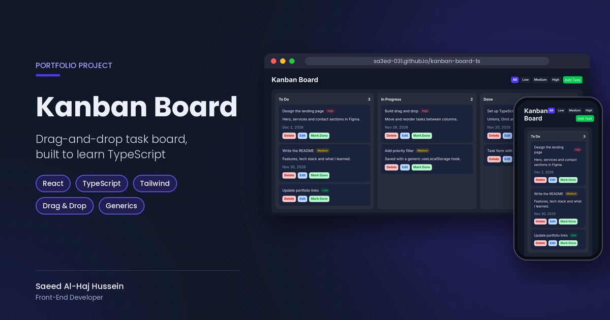

# Kanban Board · React + TypeScript

A drag-and-drop Kanban board built with **React**, **TypeScript** and **Tailwind CSS**. I built it as a hands-on project to learn TypeScript properly: every feature was a chance to practice a new type concept, from unions and narrowing to generics.

[](https://sa3ed-031.github.io/kanban-board-ts/)




---

## Features

- **Three columns:** To Do, In Progress and Done, with a live task count.
- **Add and edit tasks** in a modal form: title, description, priority and due date, with validation.
- **Drag and drop** tasks between columns, and **reorder** them inside a column.
- **Column highlight** while dragging over it.
- **Priority filter** (All, Low, Medium, High).
- **Saved automatically:** tasks and the selected filter stay after a page refresh (localStorage).
- **Readable due dates** (e.g. `Nov 27, 2026`), shown in the user's local time.
- **Accessible:** labelled form fields, a proper dialog role for the modal, and `aria-pressed` on the filter buttons.

## Tech Stack

- React 19
- TypeScript (strict mode)
- Vite
- Tailwind CSS v4
- Native HTML5 Drag and Drop API (no drag-and-drop library)

---

## What I learned about TypeScript

This project was my TypeScript playground. Here are the ideas I used, and where they live in the code:

| Concept                                                                                   | Where                                        |
| ----------------------------------------------------------------------------------------- | -------------------------------------------- |
| **Union types** for fixed values (`"todo" \| "in-progress" \| "done"`)                    | `types/task.ts`                              |
| **`Record<Priority, string>`** to make sure every priority has a label and a style        | `constants/columns.ts`, `PriorityBadge.tsx`  |
| **Utility types:** `Omit` for new tasks, `Partial` for updates                            | `types/task.ts`                              |
| **Discriminated union** for reducer actions, with an **exhaustive check** using `never`   | `types/task.ts`, `reducers/tasksReducer.ts`  |
| **Narrowing** with `switch`, `if`, `instanceof` and removing options (`filter !== "all"`) | reducer, `Column.tsx`, `App.tsx`             |
| **`null` vs `undefined`** and optional props (`?`)                                        | `App.tsx`, `TaskForm.tsx`                    |
| **Typed React events:** `ChangeEvent`, `FormEvent`, `DragEvent`                           | `TaskForm.tsx`, `TaskCard.tsx`, `Column.tsx` |
| **Generics:** a reusable `useLocalStorage<T>` hook, and `closest<HTMLElement>()`          | `hooks/useLocalStorage.ts`, `Column.tsx`     |
| **`as const`** to return a typed tuple from a hook                                        | `hooks/useLocalStorage.ts`                   |
| **`unknown` instead of `any`** for data from localStorage, checked at runtime before use  | `hooks/useTasks.ts`                          |

**Three lessons that stuck with me:**

1. **TypeScript doesn't protect everything.** A computed key like `[e.target.name]` is just a `string`, so a typo in a field name passes silently. Knowing where the checks stop matters as much as using them.
2. **`as` turns the safety off.** A type assertion is a promise to the compiler, not a check. Data from outside the app (storage, APIs) needs a real runtime check.
3. **TypeScript is a refactoring partner.** When I merged a `markDone` prop into a more general `onMove`, the compiler pointed to every place I still had to update.

📘 My full notes, with every question I worked through and its explanation: [`docs/TYPESCRIPT_NOTES.md`](./docs/TYPESCRIPT_NOTES.md) (in Arabic).

🗺️ The day-by-day plan I followed to build it: [`docs/LEARNING_PLAN.md`](./docs/LEARNING_PLAN.md) (in Arabic).

---

## Project Structure

```
src/
├── components/
│   ├── Board.tsx          # Renders the three columns
│   ├── Column.tsx         # Drop zone, highlight and reorder logic
│   ├── TaskCard.tsx       # Draggable task card
│   ├── TaskForm.tsx       # Add / edit form with validation
│   ├── Modal.tsx          # Reusable dialog
│   └── PriorityBadge.tsx
├── constants/columns.ts   # Columns, priority labels and filters
├── hooks/
│   ├── useTasks.ts        # useReducer + localStorage persistence
│   └── useLocalStorage.ts # Generic persisted state hook
├── reducers/tasksReducer.ts
├── types/task.ts          # All shared types
└── utils/date.ts          # Due date formatting
```

## Getting Started

```bash
git clone https://github.com/Sa3ed-031/kanban-board-ts.git
cd kanban-board-ts
npm install
npm run dev
```

Other scripts:

```bash
npm run build   # type-check and build for production
npm run lint    # run ESLint
```

## Possible Next Steps

- Search tasks by title
- Keyboard support for moving tasks between columns
- Sync tasks to a backend (e.g. Firebase) instead of localStorage

---

## Author

**Saeed Al-Haj Hussein** · Front-End Developer

- Portfolio: [sa3ed-031.github.io](https://sa3ed-031.github.io)
- LinkedIn: [sa3ed-al-haj-hussein](https://linkedin.com/in/sa3ed-al-haj-hussein)
- GitHub: [@Sa3ed-031](https://github.com/Sa3ed-031)
